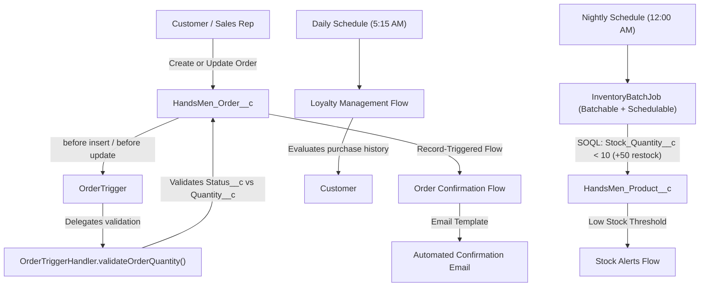
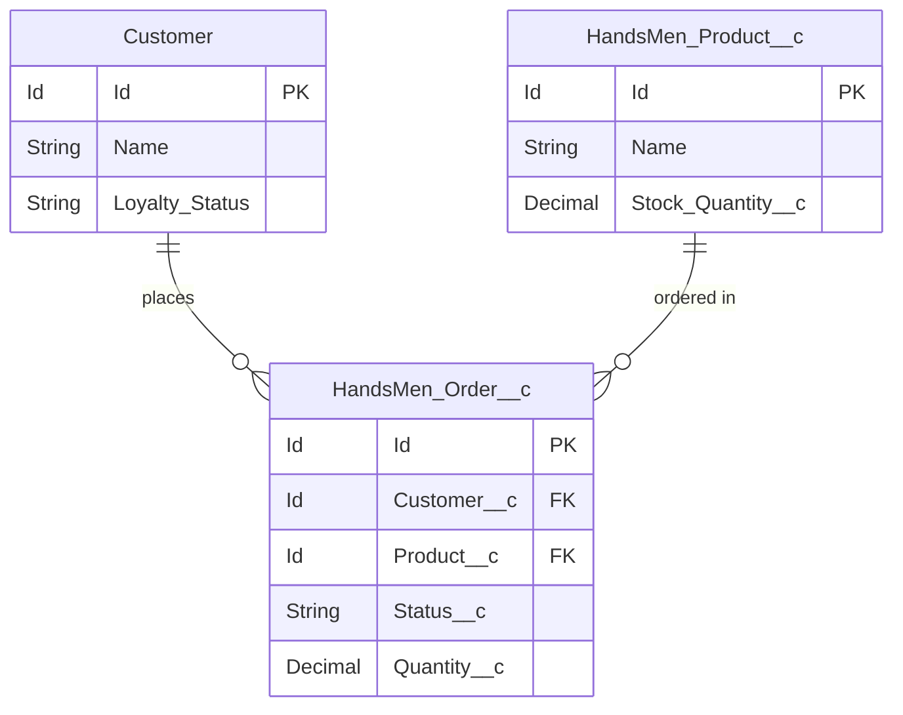

# HandsMen Threads — Salesforce CRM Solution

A Salesforce CRM implementation for **HandsMen Threads** (a fashion retail brand) designed to centralise customer relationship management, enforce order data integrity, automate customer communications and loyalty tracking, and keep product inventory synchronised through scheduled batch processing.

---

## 1. Business Problem

As a growing fashion brand, HandsMen Threads needed to move away from fragmented, manual tracking across customer records, orders, and stock levels. Key operational challenges included:

- **Order Data Integrity:** Preventing invalid order quantities from being saved against `Confirmed`, `Pending`, or `Rejection` order statuses.
- **Manual Customer Communication:** Lack of automated order confirmation emails when new orders are placed.
- **Stale Loyalty Tracking:** Customer loyalty tiers and statuses requiring manual review rather than automated daily updates based on purchase history.
- **Inventory Stockouts:** Low-stock products (`Stock_Quantity__c < 10`) not being restocked or flagged proactively, risking missed fulfilment.

---

## 2. Salesforce CRM Data Model & Relationships

The CRM solution centres on three core objects and supporting inventory tracking:

| Object | API Name | Role & Key Fields |
| :--- | :--- | :--- |
| **Customer** | `Customer` | Stores customer profile, purchase history, and loyalty status. |
| **HandsMen Product** | `HandsMen_Product__c` | Product catalogue and inventory levels (`Stock_Quantity__c`). |
| **HandsMen Order** | `HandsMen_Order__c` | Order tracking (`Status__c` — `Confirmed`, `Pending`, `Rejection`; `Quantity__c`), linked to Customer and `HandsMen_Product__c`. |

### Relationships
- **`Customer` → `HandsMen_Order__c` (One-to-Many):** Each customer can place multiple orders; order history drives automated loyalty status updates.
- **`HandsMen_Product__c` → `HandsMen_Order__c` (One-to-Many):** Each order references a product, tying order volume to inventory availability and stock alerts.

---

## 3. Architecture & Entity-Relationship Diagrams

### System Architecture (Mermaid)



### Entity-Relationship Diagram (Mermaid)



---

## 4. Apex Trigger & Handler Architecture

The order validation layer follows the **Trigger Handler Pattern** to keep triggers thin and business logic modular, testable, and `with sharing`-enforced.

### `OrderTrigger` (`force-app/main/default/triggers/OrderTrigger.trigger`)
- Fires on **`before insert`** and **`before update`** of `HandsMen_Order__c`.
- Delegates `Trigger.new` to `OrderTriggerHandler.validateOrderQuantity(Trigger.new)` when `Trigger.isBefore && (Trigger.isInsert || Trigger.isUpdate)`.

### `OrderTriggerHandler` (`force-app/main/default/classes/OrderTriggerHandler.cls`)
- Declared `public with sharing class OrderTriggerHandler`.
- Enforces order quantity rules per `Status__c` using `addError(...)` before DML commit:
  - **`Confirmed`:** `Quantity__c` must be non-null and `> 500`.
  - **`Pending`:** `Quantity__c` must be non-null and `> 200`.
  - **`Rejection`:** `Quantity__c` must be non-null and `== 0`.

### Unit Tests (`force-app/main/default/classes/OrderTriggerHandlerTest.cls`)
- `@IsTest` suite verifying valid quantities, boundary/invalid quantities, and `null` quantities across `Confirmed`, `Pending`, and `Rejection` statuses.

---

## 5. SOQL Queries

The batch restocking job queries low-stock products using a selective `Database.getQueryLocator` SOQL query:

```sql
SELECT Id, Stock_Quantity__c
FROM HandsMen_Product__c
WHERE Stock_Quantity__c < 10
```

- **Why `Database.getQueryLocator`:** Supports large product catalogues without hitting standard synchronous SOQL row limits (50,000 rows), streaming records in batches of 200.

---

## 6. Batch & Schedulable Apex (`InventoryBatchJob`)

Implemented in `force-app/main/default/classes/InventoryBatchJob.cls`, `InventoryBatchJob` implements both `Database.Batchable<SObject>` and `Schedulable`:

- **`start(Database.BatchableContext BC)`:** Returns the `QueryLocator` for `HandsMen_Product__c` records with `Stock_Quantity__c < 10`.
- **`execute(Database.BatchableContext BC, List<HandsMen_Product__c> scope)`:** Increments `Stock_Quantity__c` by `50` for each low-stock product and performs a bulk `update` wrapped in a `try/catch (DmlException)` block.
- **`finish(Database.BatchableContext BC)`:** Logs completion (`Inventory Sync Completed`).
- **`execute(SchedulableContext SC)`:** Launches `Database.executeBatch(new InventoryBatchJob(), 200)` (configured to run nightly at midnight).

---

## 7. Salesforce Flows (Declarative Automation)

Three declarative Salesforce Flows complement the Apex layer:

1. **Order Confirmation Flow:** Triggered when an order is created/confirmed; sends an automated confirmation email with order details using an Email Template.
2. **Loyalty Management Flow:** Scheduled to run daily at **5:15 AM**; evaluates customer purchase history and updates loyalty statuses automatically without manual intervention.
3. **Stock Alerts Flow:** Monitors `HandsMen_Product__c` stock levels and dispatches alerts when inventory drops below threshold, enabling proactive replenishment.

---

## 8. Why Each Feature Was Selected

| Feature / Component | Technical Choice | Rationale |
| :--- | :--- | :--- |
| **Order Quantity Validation** | Before-Save Apex Trigger + Handler (`OrderTrigger` / `OrderTriggerHandler`) | Enforces multi-status conditional rules in a single maintainable, unit-tested Apex class with `with sharing` and clean separation of concerns. |
| **Nightly Inventory Restock** | `Database.Batchable` + `Schedulable` (`InventoryBatchJob`) | Handles bulk `HandsMen_Product__c` updates asynchronously in 200-record chunks, avoiding governor limits on large catalogues. |
| **Order Confirmation Emails** | Record-Triggered Flow + Email Template | Declarative, admin-maintainable automation for instant customer communication on order creation. |
| **Daily Loyalty Updates** | Scheduled Flow (5:15 AM) | Runs off-peak to keep customer loyalty tiers synchronised with purchase history without custom Apex overhead. |
| **Low-Stock Notifications** | Stock Alerts Flow | Provides real-time visibility into low-inventory products so operations can act before stockouts occur. |

---

## 9. SFDX Deployment & Testing Instructions

### Prerequisites
- Salesforce CLI (`sf`) installed
- Target Salesforce org (Scratch Org, Sandbox, or Developer Edition) compatible with API version **`62.0`** (per `sfdx-project.json`)

### 1. Authenticate to Your Org
```bash
sf org login web --alias handsmen-org
```

### 2. Deploy Metadata (`force-app`)
```bash
sf project deploy start --source-dir force-app --target-org handsmen-org
```

### 3. Run Apex Unit Tests
```bash
sf apex run test --tests OrderTriggerHandlerTest --result-format human --code-coverage --target-org handsmen-org
```

### 4. Schedule Nightly `InventoryBatchJob` (Optional)
Run via Anonymous Apex (`sf apex run --target-org handsmen-org`) to schedule the job daily at midnight (`0 0 0 * * ?`):
```java
System.schedule('Nightly Inventory Sync', '0 0 0 * * ?', new InventoryBatchJob());
```

---

## 10. Engineering Note: SFDX Refactor & Bug Fixes

During the portfolio polish refactor, the repository was restructured from flat root-level `.java`-suffixed source files into a deployable **Salesforce DX (`force-app/main/default`)** project (`sfdx-project.json` targeting API `62.0`) with proper `.trigger`, `.cls`, and `-meta.xml` metadata descriptors:

- **Fixed SObject Type Mismatch in `InventoryBatchJob.cls`:** The legacy `InventoryBatchJob.java` queried `FROM Product__c` in `start()` while casting `scope` to `List<HandsMen_Product__c>` in `execute()`, which would fail at runtime due to an SObject type mismatch. The refactored `InventoryBatchJob.cls` corrects the query to `FROM HandsMen_Product__c`.
- **Added `with sharing` Enforcement:** Updated `OrderTriggerHandler.cls` from `public class OrderTriggerHandler` to `public with sharing class OrderTriggerHandler` to respect Salesforce sharing rules.
- **Added Automated Unit Tests:** Introduced `OrderTriggerHandlerTest.cls` covering valid, invalid, and `null` `Quantity__c` cases across `Confirmed`, `Pending`, and `Rejection` statuses so the validation logic can be verified via SFDX test runs.
